# 🌐 Awesome Network Monitoring & Packet Sniffing 📡

**The definitive curated catalog of top enterprise SaaS platforms and leading open-source GitHub projects for deep packet inspection (DPI), terminal packet sniffers, network intrusion detection systems (NIDS), eBPF kernel telemetry, and distributed infrastructure observability.**

*Last updated: November 2026*

---

## 📑 Table of Contents

- [📊 Sector Overview & Market Dynamics](#-sector-overview--market-dynamics)
- [☁️ Enterprise SaaS & Hosted Network Monitoring Platforms](#️-enterprise-saas--hosted-network-monitoring-platforms)
- [💻 Top Open-Source Network Monitoring & Packet Sniffing Tools](#-top-open-source-network-monitoring--packet-sniffing-tools)
- [🛠️ Architecture & Deployment Guide](#️-architecture--deployment-guide)
- [🤝 How to Contribute](#-how-to-contribute)
- [💖 Support & Sponsor](#-support--sponsor)
- [📈 Star History](#-star-history)
- [⚠️ Disclaimer](#️-disclaimer)

---

## 📊 Sector Overview & Market Dynamics

The global **Network Performance Monitoring and Diagnostics (NPMD)** and **Packet Analysis** market is valued at approximately **$3.8 billion to $4.5 billion** and is projected to expand at an 8.5% to 11.2% CAGR through 2030, accelerated by hybrid cloud migrations, multi-gigabit core backbones, and zero-trust security postures.

The sector is **moderately fragmented**: broad infrastructure observability and cloud-native flow analytics are dominated by large-cap and multi-billion-dollar enterprise platforms (e.g., Dynatrace, Datadog, Cisco ThousandEyes, and SolarWinds), whereas specialized wire-data decryption, Deep Packet Inspection (DPI), eBPF microservice tracing, and lightweight terminal-first capture remain fiercely contested by specialized vendors (Kentik, ExtraHop) and active open-source ecosystems (Wireshark, Zeek, Suricata, and Cilium Hubble).

---

## ☁️ Enterprise SaaS & Hosted Network Monitoring Platforms

The following enterprise network monitoring and hosted packet intelligence platforms are ranked by **Company Size (Revenue / Market Capitalization / Enterprise Valuation, Descending)**. Every pricing figure specifies verified starting tiers, and free tier limits delineate perpetual free allowances versus structured trial horizons.

| Platform | Company Size (Valuation / Revenue) | Starting Pricing (Specific Tier) | Free Tier / Trial Limit | Key Focus & Capabilities |
| :--- | :--- | :--- | :--- | :--- |
| **[Datadog NPM](https://datadoghq.com)** | **~$42B Market Cap** (~$2.1B+ Ann. Rev) | **$5.00** per host / month (billed annually, added to Pro/Enterprise infrastructure) | **14-day full-access free trial** (unlimited hosts, full NPM & flow dashboard access, no credit card required) | Cloud-native network performance monitoring, mapping container-to-container traffic, DNS resolution times, TCP retransmits, and cloud gateway flows. |
| **[Dynatrace Network Monitoring](https://dynatrace.com)** | **~$15B Market Cap** (~$1.4B+ Ann. Rev) | **$0.04** per hour for a 16 GiB host (~$29/month per host, Infrastructure Monitoring tier) | **15-day free trial** with full platform capabilities and up to 5 host agents | AI-driven full-stack observability engine providing Davis root-cause analysis, host-to-host process socket discovery, and wire latency tracking. |
| **[ManageEngine OpManager](https://manageengine.com)** | **~$1B+ Zoho Revenue** (Zoho Corp Private Valuation ~$10B–$15B) | **$245** one-time / annual for up to 25 devices (Standard Edition starting license) | **Free Forever Edition** permanently monitoring up to **3 network devices** with core SNMP/WMI sensors (or 30-day trial for up to 250 devices) | Unified on-premises and hosted network management offering automated topology maps, VoIP QoS telemetry, firewall traffic, and switch port mapper. |
| **[SolarWinds NPM](https://solarwinds.com)** | **~$1.7B Market Cap** (~$780M+ Ann. Rev) | **$1,940** perpetual license starting tier (or subscription starting at **$187/month**) | **30-day fully functional free trial** with complete NetPath hop-by-hop analysis and SNMP monitoring enabled | Enterprise backbone network monitoring featuring NetPath hop-by-hop packet inspection, Cisco ACI/SDN support, and automated alerting. |
| **[ExtraHop Reveal(x)](https://extrahop.com)** | **~$1.0B+ Valuation** (Acquired / PE ~$900M–$1B) | **$120** per sensor / month (or ~$1,500/month appliance base for mid-market cloud NDR) | **30-day guided interactive trial** / online sandbox environment with pre-populated wire PCAP datasets | Real-time wire data decryption and Network Detection & Response (NDR), inspecting L2–L7 traffic for behavioral anomalies and threat hunting. |
| **[Paessler PRTG Hosted Monitor](https://paessler.com)** | **~$200M–$300M Private Valuation** (~$60M+ Ann. Rev) | **$199** per month (PRTG Hosted 500 tier, covering up to 500 sensors across 50 devices) | **Free Forever Plan** includes **100 sensors** at zero cost after initial 30-day unlimited trial period | Multi-protocol infrastructure sensor suite leveraging SNMP, WMI, NetFlow, IPFIX, and packet sniffing to monitor servers, switches, and uplinks. |
| **[Kentik Network Intelligence](https://kentik.com)** | **~$250M Valuation** (Venture-Backed, ~$40M+ ARR) | **$200** per month (Kentik Essentials tier for foundational flow & BGP telemetry) | **30-day full-feature free trial** with multi-cloud flow ingestion and synthetic test allocations | SaaS-native network observability platform ingesting massive NetFlow, sFlow, BGP, and streaming telemetry for internet-scale traffic engineering. |
| **[Nagios XI / Cloud](https://nagios.com)** | **~$30M–$50M Valuation** (Privately Held) | **$1,295** one-time starting license for Standard Edition (100 nodes / hosts) | **Free Forever Edition** limited to monitoring **up to 7 hosts / nodes** (or 30-day unlimited host enterprise evaluation) | Commercial web interface and alerting engine for Nagios Core offering automated network discovery, capacity planning, and SLA reporting. |
| **[Zabbix Cloud](https://zabbix.com)** | **~$20M–$30M Valuation** (Privately Held) | **$39** per month (Small tier: 1 Zabbix proxy, 100 nvps, 10 GB storage) | **30-day free trial** with up to 100 nvps (new values per second) and 50 monitored network devices | Managed turnkey cloud infrastructure running open-source Zabbix server, offering SNMP traps, IPMI, ICMP, and agentless switch monitoring. |
| **[CloudShark (QA Cafe)](https://cloudshark.org)** | **~$10M–$20M Valuation** (QA Cafe / Private) | **$45** per user / month (Personal SaaS tier, billed annually) | **30-day free trial** permitting upload and collaborative analysis of up to 50 PCAP capture files | Web-native packet analysis repository ("Wireshark in your browser"), enabling security and networking teams to store, tag, decode, and share PCAPs. |

---

## 💻 Top Open-Source Network Monitoring & Packet Sniffing Tools

The following open-source packet sniffers, intrusion detection engines, terminal monitors, and flow collectors are ranked by **GitHub Stars_Count (Descending)**. Every project includes its live social Stars_Badge linking directly to its stargazers page.

| Repository | GitHub_Stars | Core Domain | Description |
| :--- | :---: | :--- | :--- |
| **[Netdata](https://github.com/netdata/netdata)** |  | Infrastructure & eBPF Telemetry | Real-time open-source infrastructure agent streaming per-second socket, interface, TCP/UDP, and eBPF network metrics with zero latency. |
| **[mitmproxy](https://github.com/mitmproxy/mitmproxy)** |  | SSL/TLS Interception & Proxying | Interactive SSL/TLS-capable intercepting HTTP/1, HTTP/2, HTTP/3, and WebSocket proxy with console, web UI (`mitmweb`), and Python scripting. |
| **[Sniffnet](https://github.com/GyulyVGC/sniffnet)** |  | Cross-Platform Desktop Sniffer | Intuitive, cross-platform Rust application for real-time traffic inspection, protocol breakdown, geolocation mapping, and visual network alerts. |
| **[Scapy](https://github.com/secdev/scapy)** |  | Packet Forging & Dissection | Powerful interactive Python packet manipulation engine for forging, decoding, sniffing, and injecting custom frames across OSI layers 2–7. |
| **[Kubeshark](https://github.com/kubeshark/kubeshark)** |  | Kubernetes API Traffic Sniffer | API traffic analyzer and Wireshark-like deep packet inspection tool specifically engineered for Kubernetes clusters and microservices. |
| **[Bandwhich](https://github.com/imsnif/bandwhich)** |  | CLI Process Bandwidth Sniffer | Terminal bandwidth utilization utility written in Rust that sniffs raw packets and maps live uplink/downlink speeds directly to OS processes. |
| **[Wireshark](https://github.com/wireshark/wireshark)** |  | Deep Protocol Analyzer & Dissector | The world's foremost GUI network protocol analyzer and CLI dissector (`tshark`), decoding thousands of wired, wireless, and industrial protocols. |
| **[Termshark](https://github.com/gcla/termshark)** |  | TUI Terminal Protocol Analyzer | Interactive terminal UI (TUI) for `tshark` inspired by Wireshark, enabling remote PCAP analysis and live frame dissection over SSH sessions. |
| **[ntopng](https://github.com/ntop/ntopng)** |  | Web Flow Monitor & DPI Probe | High-speed web-based traffic analysis and flow collection probe featuring `nDPI` deep packet inspection, top talkers, and behavioral alerts. |
| **[Zeek](https://github.com/zeek/zeek)** |  | Network Security Monitoring (NSM) | Scalable network security monitoring framework transforming live wire traffic into structured transaction logs (`conn.log`, `dns.log`, `ssl.log`). |
| **[Trippy](https://github.com/fujiapple852/trippy)** |  | TUI Network Path Diagnostics | Modern network diagnostic TUI written in Rust combining traceroute and ping with ASN, GeoIP, and packet-loss jitter analysis. |
| **[Arkime](https://github.com/arkime/arkime)** |  | Large-Scale PCAP Indexing | Open-source indexed packet capture (PCAP) and search system capable of storing and querying terabytes of full-packet network sessions. |
| **[Suricata](https://github.com/OISF/suricata)** |  | Multi-Threaded NIDS / IPS / NSM | High-performance, multi-threaded open-source Network IDS, IPS, and NSM engine with hardware acceleration, Lua scripting, and PCAP capture. |
| **[Zabbix](https://github.com/zabbix/zabbix)** |  | Distributed Enterprise Monitoring | Enterprise open-source distributed monitoring platform tracking SNMP, ICMP, flow telemetry, network switches, routers, and server metrics. |
| **[LibreNMS](https://github.com/librenms/librenms)** |  | Auto-Discovering SNMP NMS | Community-driven PHP/MySQL network monitoring system supporting SNMP auto-discovery, BGP, OSPF, NetFlow, and topology mapping. |
| **[Cilium Hubble](https://github.com/cilium/hubble)** |  | eBPF Cloud-Native Observability | eBPF-powered network, service, and security observability platform providing deep microservice traffic visibility and flow graphs. |
| **[Nethogs](https://github.com/raboof/nethogs)** |  | Per-Process CLI Bandwidth Monitor | Compact net-top utility grouping network traffic bandwidth by process PID rather than by network interface or protocol. |
| **[tcpdump / libpcap](https://github.com/the-tcpdump-group/tcpdump)** |  | Ubiquitous CLI Packet Capture | The foundational, ubiquitous command-line packet analyzer and C capture library powering decades of Linux and BSD network troubleshooting. |
| **[Akvorado](https://github.com/akvorado/akvorado)** |  | ClickHouse NetFlow/sFlow Visualizer | High-volume flow collector and visualizer using ClickHouse and Kafka to stream NetFlow/sFlow/IPFIX data into interactive interface maps. |
| **[Icinga 2](https://github.com/Icinga/icinga2)** |  | Scalable Availability Monitoring | Modular open-source network monitoring and service availability checking engine featuring a clean DSL, REST API, and distributed clustering. |
| **[Nagios Core](https://github.com/NagiosEnterprises/nagioscore)** |  | Host & Service Check Daemon | Industry-standard open-source host, service, and network infrastructure monitoring daemon and battle-tested alerting pipeline. |
| **[bmon](https://github.com/tgraf/bmon)** |  | TUI Interface Bandwidth Monitor | Lightweight bandwidth monitor and rate estimator displaying real-time ASCII/curses interactive graphs for Linux network interfaces. |
| **[Snitch](https://github.com/aixisstudio/Snitch)** |  | Lightweight Traffic Sniffer | Modern, open-source network monitoring and packet inspection utility engineered for real-time visibility into active socket connections and flows. |
| **[goflow2](https://github.com/netsampler/goflow2)** |  | High-Performance Flow Pipeline | High-throughput NetFlow v5/v9, IPFIX, and sFlow collector pipeline written in Go, exporting enriched JSON events into Kafka, Prometheus, or files. |

---

## 🛠️ Architecture & Deployment Guide

When designing an enterprise-grade network monitoring pipeline, engineers typically combine tools across four distinct layers:

1. **Wire Capture & Packet Dissection (L2–L4)**: Use `tcpdump` and `Wireshark / TShark` for raw PCAP capture and micro-level protocol dissection, or `Termshark` for remote triage over SSH.
2. **High-Throughput Deep Packet Inspection & NSM (L4–L7)**: Deploy `Zeek` alongside `Suricata` to transform Gigabit wire traffic into structured transaction telemetry and intrusion alerts without storing prohibitive volumes of payload data.
3. **Flow Telemetry & Topology Mapping**: Ingest NetFlow v9, IPFIX, and sFlow via `goflow2` or `Akvorado`, and aggregate SNMP switch telemetry via `LibreNMS` or `Zabbix`.
4. **Cloud-Native & eBPF Observability**: Instrument Kubernetes nodes with `Cilium Hubble` or `Kubeshark` to intercept microservice service-to-service payloads without kernel-space context switching penalties.

---

## 🤝 How to Contribute

We actively welcome contributions to keep this repository the most comprehensive resource on the web!

1. 🍴 **Fork the repository** on GitHub.
2. 🌿 **Create a feature branch**: `git checkout -b feature/add-new-tool`.
3. 📝 **Add your entry**: Ensure SaaS entries include verified starting prices, company valuation/revenue, and exact free tier limits. For open-source tools, include the repository URL, description, and appropriate Stars_Badge.
4. 🧪 **Check Markdown formatting**: Verify that markdown tables render cleanly and follow descending sorting order.
5. 🚀 **Submit a Pull Request** with a concise description of why the tool should be indexed.

---

## 💖 Support & Sponsor

If you find this curated ecosystem tracker helpful, please consider supporting the project:

- ⭐ **Star this repository** to help other network engineers, SOC analysts, and DevOps practitioners discover it on GitHub.
- 🍴 **Fork and contribute** to keep the tools, benchmarks, and pricing matrices up to date.
- 📢 **Share with colleagues**, network engineering forums, and Reddit communities (`r/networking`, `r/homelab`, `r/sysadmin`).
- ☕ **Buy me a coffee / Sponsor**: Support continuous maintenance and independent curation via the [GitHub Sponsors Dashboard](https://github.com/sponsors/ishandutta2007).

---

## 📈 Star History

---

## ⚠️ Disclaimer

- This is a **community-curated directory** created for educational, research, and operational visibility purposes — inclusion does not constitute an endorsement.
- Packet sniffing and deep packet inspection (`tcpdump`, `Wireshark`, `mitmproxy`, `Arkime`) can capture unencrypted sensitive data including session tokens, passwords, and personal communications. **Only inspect network interfaces, routers, and traffic flows that you own or have explicit, documented authorization to monitor.**
- Ensure that PCAP archives and telemetry storage comply with local privacy statutes (e.g., GDPR, CCPA, HIPAA) and corporate retention governance.
